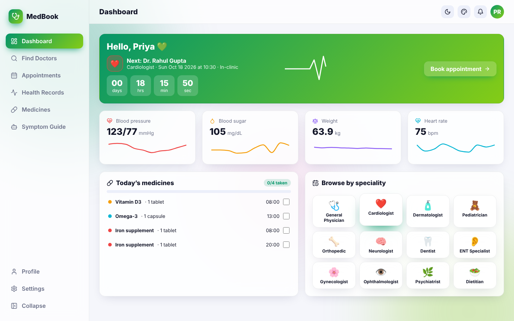
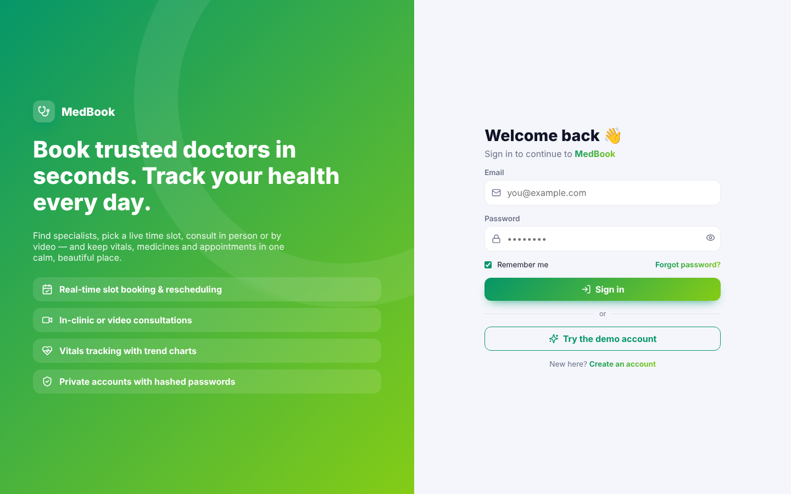
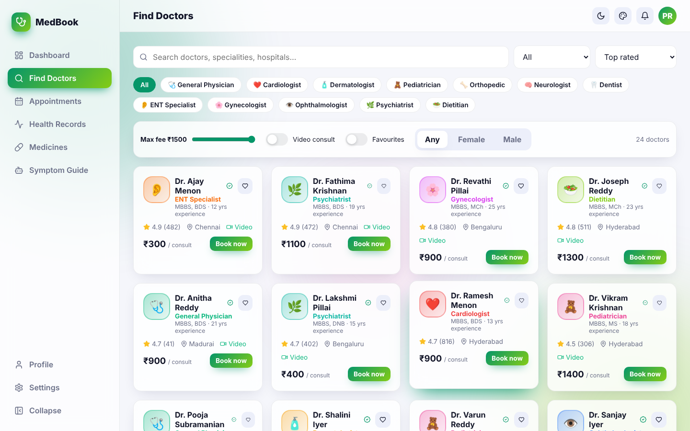
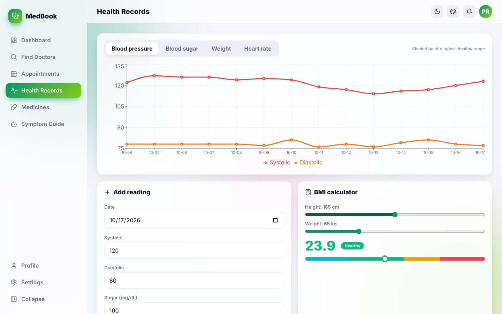

<div align="center">

# 🩺 MedBook

### Doctor appointment booking with live time slots, video consults & a personal health dashboard


</div>



## ✨ Features

| Area | What you get |
|---|---|
| 🔐 **Auth** | Register & login with salted SHA-256 hashing, password-strength meter, remember-me, demo account, protected routes, profile & password management |
| 🏠 **Dashboard** | Next-appointment card with a **live countdown**, animated ECG line, vitals tiles with sparklines, today’s medicine checklist, speciality shortcuts |
| 🔎 **Find Doctors** | 24 doctors across 12 specialities · search · city, max-fee, gender, video-consult & favourites filters · 4 sort modes |
| 📅 **Real-time booking** | 10-day date strip respecting each doctor’s working days, slot grid with already-booked and past slots disabled, in-clinic or video, reason for visit, animated confirmation with booking ID |
| 🗓️ **Appointments** | Upcoming / completed / cancelled tabs, reschedule with the slot picker, cancel, mark done, rate the visit, **download .ics** calendar invite, join video |
| 📈 **Health records** | Blood pressure, sugar, weight & heart-rate trend charts with healthy-range bands, add/delete readings, history table, interactive **BMI calculator** |
| 💊 **Medicines** | Reminders with multiple daily times and colour tags, tap-to-take doses, daily adherence progress ring |
| 🤖 **Symptom guide** | Choose symptoms → ranked speciality suggestions with urgent-care warnings and one-click doctor search |
| 🎨 **Themes** | Light / Dark / Midnight / Sepia / System · 6 accents · radius slider · compact & reduced-motion modes |
| 🎞️ **Animations** | ECG draw animation, heartbeat pulse, page transitions, staggered cards, pop-in slots & modals, success check, toasts |

## 🖼️ Screenshots

| Login | Find Doctors | Health Records |
|---|---|---|
|  |  |  |

## 🚀 Getting started

```bash
git clone https://github.com/PreciousBharath/MEDBOOK-DOCTOR-APPOINTMENT-APP.git
cd MEDBOOK-DOCTOR-APPOINTMENT-APP
npm install
npm run dev
```

Demo login: `demo@medbook.app` / `Demo@1234`, or register.

## 🧱 Structure

```
src/
├── data.js        # Doctors, specialities, slots, availability, symptom map
├── health.jsx     # Per-user appointments, vitals, medicines, favourites
├── auth.jsx · theme.jsx · toast.jsx · storage.js
├── components/    # Doctor (DoctorCard, SlotPicker, BookingModal), Layout, ThemePanel…
└── pages/         # Dashboard, Doctors, Appointments, Vitals, Medicines, Symptoms, Login, Register…
```

## 🛠️ Tech stack

React 18 · React Router 6 · Recharts · Lucide icons · Vite · SVG/CSS animations · Web Crypto API · localStorage

> ⚕️ For demonstration only — doctors are fictional and the symptom guide is not medical advice.

## 📄 License

MIT © [Bharath](https://github.com/PreciousBharath)
